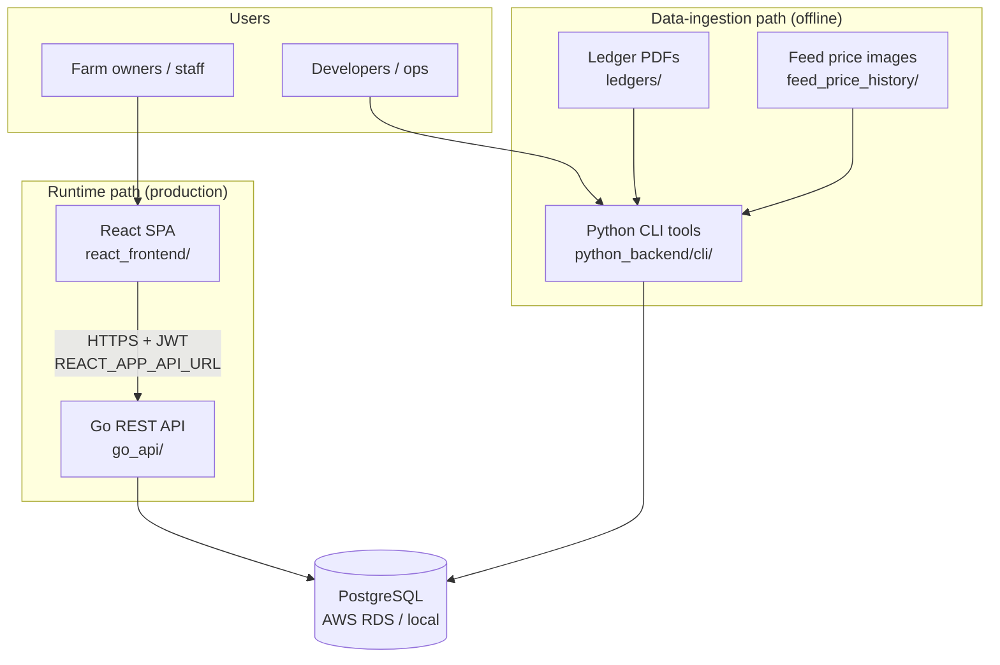
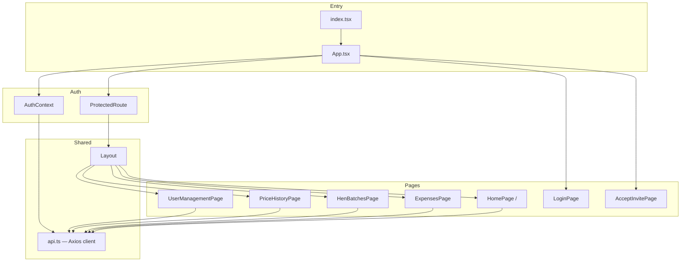
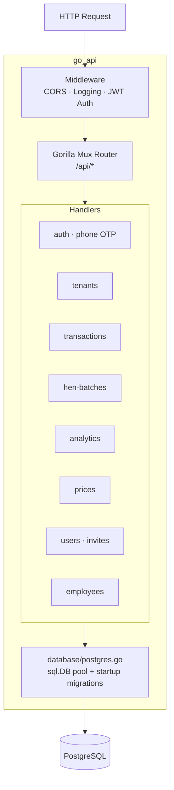
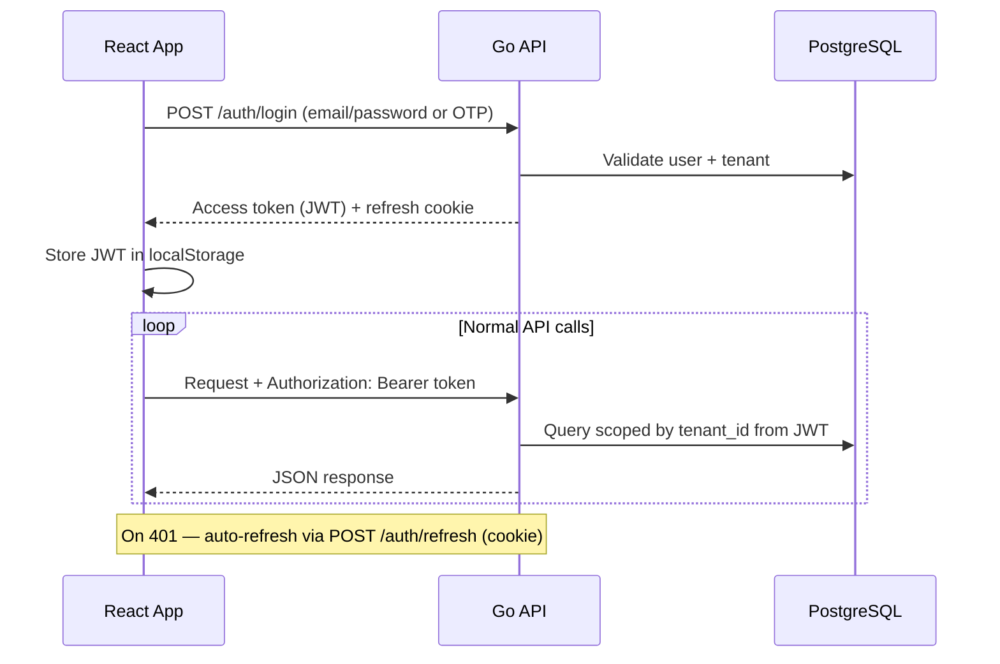
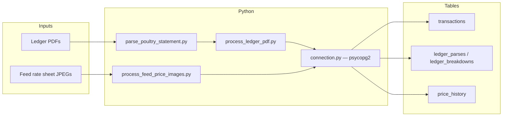
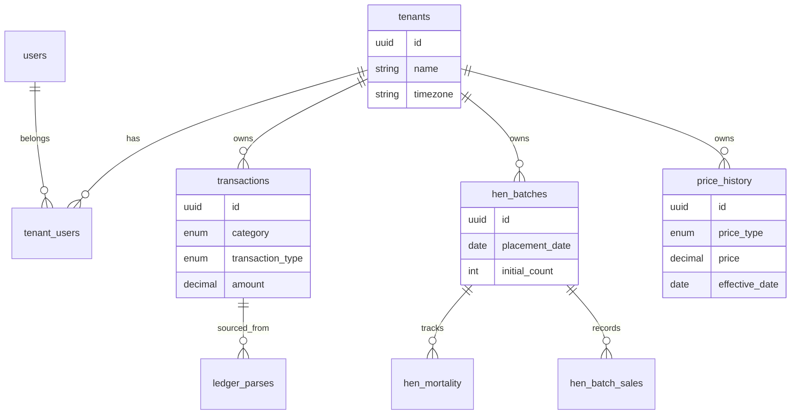
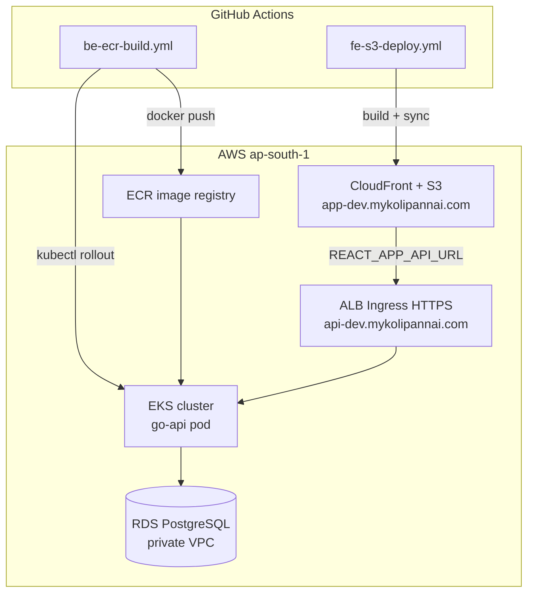
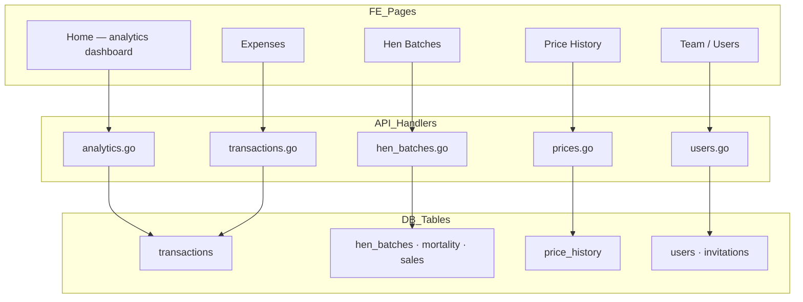
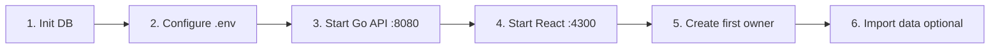

# Architecture Overview

**Kolipannai** (`poultry_farm_auditor`) is a multi-tenant poultry farm management platform. Farm owners and staff use it to track transactions (sales, purchases, expenses), hen batches, feed/egg prices, and analytics.

This document describes how the frontend, backend, database, data-ingestion tools, and AWS deployment fit together.

For first-time setup steps, see [ONBOARDING_GUIDE.md](ONBOARDING_GUIDE.md).  
For a shorter slide-style summary, see [ARCHITECTURE_KICKOFF.md](ARCHITECTURE_KICKOFF.md).

---

## Table of Contents

1. [High-Level Overview](#1-high-level-overview)
2. [Frontend (React)](#2-frontend-react)
3. [Backend (Go API)](#3-backend-go-api)
4. [Authentication](#4-authentication)
5. [Data Ingestion (Python)](#5-data-ingestion-python)
6. [Database](#6-database)
7. [Production Deployment (AWS)](#7-production-deployment-aws)
8. [Domain Modules](#8-domain-modules)
9. [Repository Map](#9-repository-map)
10. [Local Development](#10-local-development)

---

## 1. High-Level Overview

There are **two paths** into the system:

| Path | Flow | When used |
|------|------|-----------|
| **Runtime** | React SPA → Go REST API → PostgreSQL | Production; all user interactions |
| **Data ingestion** | Python CLI → PostgreSQL (direct) | Offline import of ledger PDFs and feed-price images |



| Layer | Technology | Role |
|-------|------------|------|
| Frontend | React + TypeScript (CRA) | User-facing SPA |
| Backend API | Go 1.19 + Gorilla Mux | Serves all HTTP requests |
| Data pipeline | Python 3 + psycopg2 | PDF/OCR import (no HTTP server) |
| Database | PostgreSQL 15 | Single source of truth |

---

## 2. Frontend (React)

### Stack

- **Framework:** React 18 + TypeScript
- **Build tool:** Create React App (`react-scripts`)
- **Routing:** `react-router-dom` v6
- **HTTP client:** Axios
- **Charts:** Recharts
- **State:** `AuthContext` for auth/tenant; per-page `useState` / `useEffect` (no Redux)

### Entry Points

| File | Purpose |
|------|---------|
| `react_frontend/src/index.tsx` | Mounts `<App />` |
| `react_frontend/src/App.tsx` | Router + auth wrapper |
| `react_frontend/src/services/api.ts` | Centralized Axios client |
| `react_frontend/public/index.html` | HTML shell |

### Routes

| Route | Page | Auth |
|-------|------|------|
| `/login` | `LoginPage` | Public |
| `/accept-invite` | `AcceptInvitePage` | Public |
| `/` | `HomePage` (dashboard / analytics) | Protected |
| `/expenses` | `ExpensesPage` | Protected |
| `/hen-batches` | `HenBatchesPage` | Protected |
| `/price-history` | `PriceHistoryPage` | Protected |
| `/team` | `UserManagementPage` | Protected |

All protected routes are wrapped in `ProtectedRoute` + `Layout`.

### API Client Pattern

`react_frontend/src/services/api.ts` creates an Axios instance:

- `baseURL` = `REACT_APP_API_URL` (default `http://localhost:8080/api`)
- `withCredentials: true` for refresh-token cookies
- Request interceptor: `Authorization: Bearer <token>`, `X-Device-Id`
- Response interceptor: auto-refresh on 401 via `POST /auth/refresh`
- Named API modules: `authAPI`, `transactionsAPI`, `henBatchesAPI`, `analyticsAPI`, `usersAPI`, `tenantsAPI`, etc.

### Frontend Architecture Diagram



### URLs

| Environment | Frontend URL | API URL (`REACT_APP_API_URL`) |
|-------------|--------------|-------------------------------|
| Local | `http://localhost:4300` | `http://localhost:8080/api` |
| Production | `https://app-dev.mykolipannai.com` | `https://api-dev.mykolipannai.com/api` |

Local dev: `PORT=4300 npm start` (project standardizes on port 4300, not CRA default 3000).

---

## 3. Backend (Go API)

### Stack

- **Language:** Go 1.19
- **Router:** Gorilla Mux
- **Database:** `database/sql` + `github.com/lib/pq` (no ORM)
- **Auth:** `golang-jwt/jwt/v5`, `golang.org/x/crypto/bcrypt`

Python does **not** serve HTTP in production. All frontend requests go through the Go API.

### Directory Structure

```
go_api/
├── main.go              # Gorilla Mux router, route registration
├── config/config.go     # Env-based config
├── database/postgres.go # sql.DB pool + inline migrations on startup
├── middleware/          # auth (JWT), CORS, logging
├── handlers/            # auth, tenants, transactions, hen-batches, analytics, prices, users...
├── models/              # Go structs
└── Dockerfile           # Multi-stage → alpine, port 8080
```

### Request Flow



### API Conventions

- Base path: `/api`
- Health checks: `/health`, `/api/health`
- Success response: `{ "success": true, "data": ... }`
- Error response: `{ "error": "..." }`

### Route Groups

| Group | Examples | Auth |
|-------|----------|------|
| Public | `/auth/login`, `/auth/send-otp`, `/auth/verify-otp`, `/auth/refresh`, `/users/accept-invite` | None |
| Protected | `/transactions`, `/hen-batches`, `/analytics/*`, `/prices`, `/users` | JWT Bearer |
| Admin (dev) | `/admin/create-owner`, `/admin/create-tenant` | `X-Admin-Key` header |

### Key Environment Variables

| Variable | Purpose |
|----------|---------|
| `DB_HOST`, `DB_PORT`, `DB_NAME`, `DB_USER`, `DB_PASSWORD`, `DB_SSLMODE` | Database connection |
| `API_PORT` | Server port (default 8080) |
| `JWT_SECRET` | JWT signing key |
| `CORS_ALLOWED_ORIGINS` | Allowed frontend origins |
| `FRONTEND_URL` | Used in invitation email links |

---

## 4. Authentication



| Mechanism | Details |
|-----------|---------|
| Login | Email/password or phone OTP |
| Access token | JWT in `Authorization: Bearer` header; stored in `localStorage` |
| Refresh token | HTTP-only cookie; session stored in `auth_sessions` table |
| Device tracking | `X-Device-Id` header on all requests |
| Multi-tenant | JWT carries active `tenant_id`; users can belong to multiple tenants |
| RBAC | `tenant_users.role` + `role_permissions` (view/edit/approve/manage/charts) |
| Roles | OWNER, CO_OWNER, MANAGER, OTHER_USER, ADMIN |

---

## 5. Data Ingestion (Python)

Python tools **bypass the Go API** and write directly to PostgreSQL. The Go API then serves that data to the frontend.



### CLI Tools

| Script | Input | Output tables |
|--------|-------|---------------|
| `python_backend/cli/init_database.py` | — | Full schema bootstrap |
| `python_backend/cli/process_ledger_pdf.py` | Supplier ledger PDFs | `transactions`, `ledger_parses`, `ledger_breakdowns` |
| `python_backend/cli/process_feed_price_images.py` | Everest feed rate images | `price_history` (type FEED) |
| `python_backend/cli/setup_tenant_items.py` | — | `tenant_items` seed data |
| `parse_poultry_statement.py` (root) | PDF bytes | Used by ledger CLI; core parser logic |

### Agent Skills (Cursor)

- `.cursor/skills/parse-ledger-pdf/SKILL.md` — ledger PDF workflow
- `.cursor/skills/load-feed-prices/SKILL.md` — feed price image workflow

---

## 6. Database

### Engine and Hosting

| Environment | Setup |
|-------------|-------|
| Local | Docker or local Postgres (`poultry_farm` database) |
| AWS | RDS PostgreSQL 15 in private VPC subnets |

### Schema Management

There is no formal migration framework (Flyway/Liquibase). Schema evolves via:

1. **Canonical dump:** `database/schema.sql` (pg_dump schema-only)
2. **Python DDL:** `python_backend/database/schema.py` (used by `init_database.py`)
3. **Incremental SQL:** root `*.sql` files (e.g. `add_payment_period_fields.sql`)
4. **Go startup migrations:** inline `ALTER TABLE` in `go_api/database/postgres.go`

### Core Tables

| Table | Domain |
|-------|--------|
| `tenants` | Multi-tenant farms (UUID, timezone, financial year, age categories) |
| `users`, `tenant_users` | Auth + per-tenant roles |
| `transactions` | Sales, purchases, payments, TDS, discounts, expenses/income |
| `hen_batches`, `hen_mortality`, `hen_batch_sales` | Flock management |
| `price_history` | Feed and egg price time series |
| `ledger_parses`, `ledger_breakdowns` | PDF import audit trail |
| `tenant_items` | Configurable item catalog per tenant |
| `role_permissions` | RBAC flags |
| `invitations`, `otp_codes`, `auth_sessions` | Auth flows |

### Entity Relationships (simplified)



Both Go and Python use the same `DB_*` environment variables to connect.

---

## 7. Production Deployment (AWS)



### Infrastructure

| Component | Location | Purpose |
|-----------|----------|---------|
| Terraform | `infra/` | VPC, EKS, RDS, S3/CloudFront, ECR, bastion, GitHub OIDC |
| Kubernetes | `k8s/go-api/` | Deployment, service, ingress (ALB + ACM cert) |
| CI/CD | `.github/workflows/` | FE S3 deploy, BE ECR build + EKS rollout, API regression |

### CI/CD Workflows

| Workflow | Trigger | Action |
|----------|---------|--------|
| `fe-s3-deploy.yml` | Push to `main` (FE changes) | Build React → S3 sync → CloudFront invalidation |
| `be-ecr-build.yml` | Manual / tag | Docker build → ECR push → kubectl rollout on EKS |
| `api-post-deploy-regression.yml` | After BE deploy | API smoke tests |
| `be-auto-semver-tag.yml` | — | Version tagging |

### Environment URLs

| Component | Local | Production |
|-----------|-------|------------|
| Frontend | `http://localhost:4300` | `https://app-dev.mykolipannai.com` |
| API | `http://localhost:8080/api` | `https://api-dev.mykolipannai.com/api` |
| Database | Local Postgres | RDS (private VPC, access via bastion) |

See also: [FRONTEND_DEPLOYMENT_GUIDE.md](FRONTEND_DEPLOYMENT_GUIDE.md), [infra/README.md](infra/README.md), [API_HTTPS_SETUP.md](API_HTTPS_SETUP.md).

---

## 8. Domain Modules



| Domain | Frontend | API handler | Key tables | Data import |
|--------|----------|-------------|------------|-------------|
| Ledger / transactions | Home, Expenses | `transactions.go` | `transactions`, `ledger_parses` | `process_ledger_pdf.py` |
| Analytics | Home charts | `analytics.go` | Aggregations over `transactions` | — |
| Hen batches | Hen Batches | `hen_batches.go` | `hen_batches`, `hen_mortality`, `hen_batch_sales` | Manual entry via UI |
| Prices | Price History | `prices.go` | `price_history` | `process_feed_price_images.py` |
| Users / tenants | Team | `users.go`, tenant handlers | `users`, `tenant_users`, `invitations` | `setup_first_owner.sh` |
| Employees | — | `employees.go` | `employees` | Manual entry via API |

---

## 9. Repository Map

```
automate_using_python/
├── react_frontend/       # React SPA (user-facing app)
├── go_api/               # Production REST API (Go)
├── python_backend/       # DB utilities + CLI import tools (Python)
│   ├── cli/              # process_ledger_pdf, process_feed_price_images, init_database...
│   └── database/         # connection.py, schema.py
├── database/             # schema.sql dump + docs
├── infra/                # Terraform (AWS: VPC, EKS, RDS, S3/CloudFront)
├── k8s/                  # Kubernetes manifests for Go API
├── scripts/              # Deploy/ops helpers, backfills, regression tests
├── ledgers/              # Input ledger PDFs
├── feed_price_history/   # Input feed rate sheet images (by year)
├── tests/                # Python parse tests
├── postman/              # API collections
└── .github/workflows/    # CI/CD pipelines
```

---

## 10. Local Development



### Quick Start

```bash
# 1. Initialize database
python3 python_backend/cli/init_database.py

# 2. Configure environment (.env at repo root)
#    DB_HOST, DB_PORT, DB_NAME, DB_USER, DB_PASSWORD, JWT_SECRET

# 3. Start Go API
cd go_api && go run main.go

# 4. Start React (separate terminal)
cd react_frontend
REACT_APP_API_URL=http://localhost:8080/api PORT=4300 npm start

# 5. Create first owner
./setup_first_owner.sh

# 6. (Optional) Import data
python3 python_backend/cli/process_ledger_pdf.py --help
python3 python_backend/cli/process_feed_price_images.py --help
```

### Further Reading

| Document | Topic |
|----------|-------|
| [ONBOARDING_GUIDE.md](ONBOARDING_GUIDE.md) | First-user setup, invite flow |
| [AI_AGENT_GUIDE_clean.md](AI_AGENT_GUIDE_clean.md) | Comprehensive system reference |
| [GO_API_IMPLEMENTATION_SUMMARY.md](GO_API_IMPLEMENTATION_SUMMARY.md) | Go API details |
| [FRONTEND_DEPLOYMENT_GUIDE.md](FRONTEND_DEPLOYMENT_GUIDE.md) | FE deploy to S3/CloudFront |
| [PRICE_VALIDATION_README.md](PRICE_VALIDATION_README.md) | Feed/egg price validation |

---

## One-Liner Summary

> Users hit a React app on CloudFront; it talks to a Go API on EKS, which reads/writes PostgreSQL on RDS. Ledger PDFs and feed-price images are imported offline by Python scripts that write to the same database — the API does not parse files itself.
