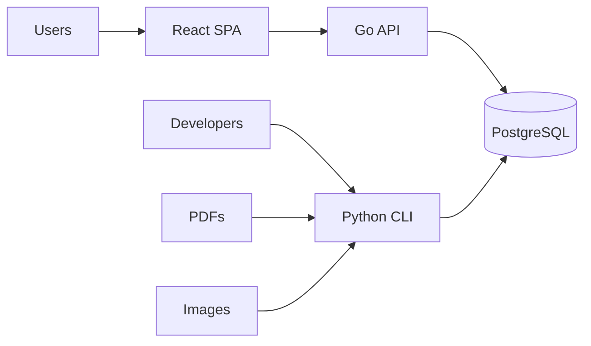
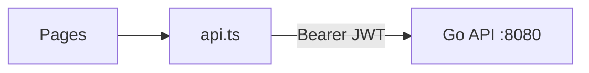
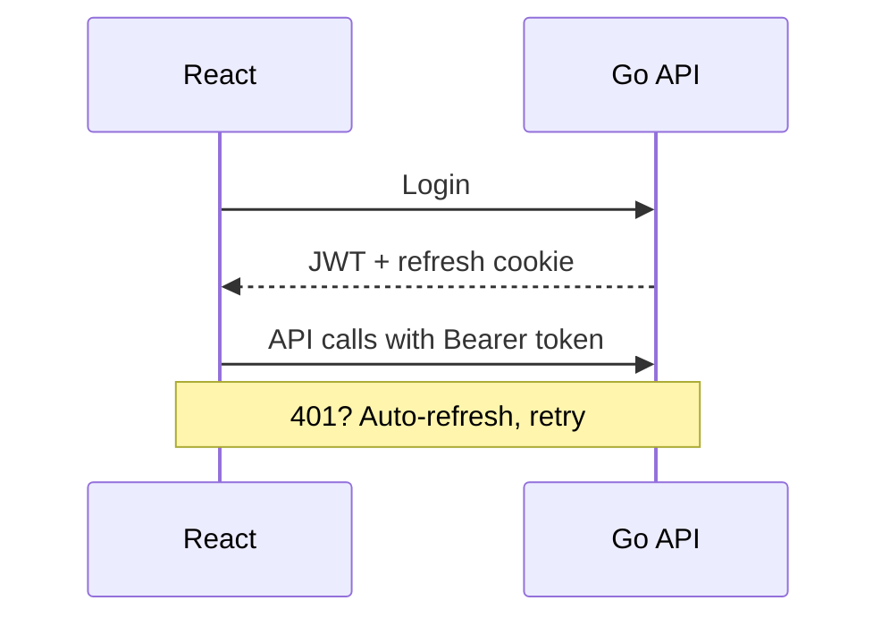
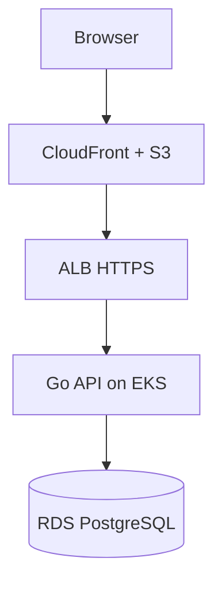

# Kolipannai — Architecture Kickoff

**Audience:** New teammates  
**Duration:** ~15 minutes  
**Full reference:** [ARCHITECTURE.md](ARCHITECTURE.md)

---

## Slide 1 — What We Build

**Kolipannai** is a multi-tenant poultry farm management platform.

Farm owners and staff use it to:

- Track sales, purchases, expenses, and payments
- Manage hen batches (placement, mortality, sales)
- View feed and egg price history
- See analytics dashboards (monthly/yearly summaries)
- Invite team members with role-based access

---

## Slide 2 — The One-Liner

> Users hit a **React app** on CloudFront → it calls a **Go API** on EKS → which reads/writes **PostgreSQL** on RDS.
>
> Ledger PDFs and feed-price images are imported **offline by Python scripts** that write to the same database. The API does not parse files.

---

## Slide 3 — Two Paths Into the System



| Path | Who | How |
|------|-----|-----|
| **Runtime** | Farm users | Browser → React → Go API → DB |
| **Data import** | Developers | Python scripts → DB (direct) |

---

## Slide 4 — Tech Stack at a Glance

| Layer | Tech | Folder |
|-------|------|--------|
| Frontend | React + TypeScript (CRA) | `react_frontend/` |
| Backend API | Go 1.19 + Gorilla Mux | `go_api/` |
| Data import | Python 3 + psycopg2 | `python_backend/cli/` |
| Database | PostgreSQL 15 | `database/schema.sql` |
| Infra | AWS (EKS, RDS, S3, CloudFront) | `infra/`, `k8s/` |
| CI/CD | GitHub Actions | `.github/workflows/` |

---

## Slide 5 — Frontend

**What it is:** Single-page app, no server-side rendering.

**Key facts:**
- Port **4300** locally (`PORT=4300 npm start`)
- Routes: `/` (dashboard), `/expenses`, `/hen-batches`, `/price-history`, `/team`
- Auth via `AuthContext` — JWT in `localStorage`, refresh via cookie
- All API calls go through `src/services/api.ts` (Axios)



**Prod URL:** `https://app-dev.mykolipannai.com`

---

## Slide 6 — Backend (Go API)

**What it is:** The only HTTP server in production. Python does not serve requests.

**Key facts:**
- Raw SQL in handlers (no ORM)
- JWT middleware on protected routes
- Multi-tenant: every query scoped by `tenant_id` from the token
- Inline DB migrations run on startup

**Main route groups:**

| Prefix | Domain |
|--------|--------|
| `/api/auth/*` | Login, OTP, refresh |
| `/api/transactions` | Ledger entries |
| `/api/hen-batches` | Flock management |
| `/api/analytics/*` | Dashboard charts |
| `/api/prices` | Feed & egg prices |
| `/api/users` | Team & invites |

**Prod URL:** `https://api-dev.mykolipannai.com/api`

---

## Slide 7 — Authentication (30 seconds)



- **Roles:** OWNER, CO_OWNER, MANAGER, OTHER_USER, ADMIN
- **Permissions:** view / edit / approve / manage / charts (per role)
- **Multi-tenant:** one user can access multiple farms

---

## Slide 8 — Data Import (Python)

**When:** Developers import historical data — not part of the live user flow.

| Tool | Input | Writes to |
|------|-------|-----------|
| `process_ledger_pdf.py` | Supplier ledger PDFs | `transactions`, `ledger_parses` |
| `process_feed_price_images.py` | Feed rate sheet JPEGs | `price_history` |
| `init_database.py` | — | Full schema |

**Core parser:** `parse_poultry_statement.py` (root)

Inputs live in `ledgers/` and `feed_price_history/`.

---

## Slide 9 — Production (AWS)



| Component | Service | Region |
|-----------|---------|--------|
| Frontend hosting | S3 + CloudFront | `ap-south-1` |
| API hosting | EKS (Kubernetes) | `ap-south-1` |
| Database | RDS PostgreSQL (private VPC) | `ap-south-1` |
| Deploy | GitHub Actions → S3 / ECR | — |

**FE deploy:** push to `main` → auto build + S3 sync  
**BE deploy:** manual workflow → Docker → ECR → kubectl rollout

---

## Slide 10 — Domain Map

| What users see | API | DB tables |
|----------------|-----|-----------|
| Dashboard / Home | `analytics.go` | `transactions` (aggregated) |
| Expenses | `transactions.go` | `transactions` |
| Hen Batches | `hen_batches.go` | `hen_batches`, `hen_mortality`, `hen_batch_sales` |
| Price History | `prices.go` | `price_history` |
| Team | `users.go` | `users`, `tenant_users`, `invitations` |

---

## Slide 11 — Repo Map (Where to Look)

```
react_frontend/     ← UI code
go_api/             ← API code (start here for backend)
python_backend/cli/ ← import scripts
database/           ← schema.sql
infra/ + k8s/       ← AWS + Kubernetes
scripts/            ← deploy helpers
```

**Docs to bookmark:**
- [ARCHITECTURE.md](ARCHITECTURE.md) — full architecture reference
- [ONBOARDING_GUIDE.md](ONBOARDING_GUIDE.md) — first-user setup
- [AI_AGENT_GUIDE_clean.md](AI_AGENT_GUIDE_clean.md) — deep system reference

---

## Slide 12 — Local Setup (5 commands)

```bash
python3 python_backend/cli/init_database.py     # 1. DB
# 2. Set .env (DB_*, JWT_SECRET)
cd go_api && go run main.go                     # 3. API :8080
cd react_frontend && PORT=4300 npm start        # 4. FE :4300
./setup_first_owner.sh                          # 5. First user
```

Open `http://localhost:4300` — API at `http://localhost:8080/api`.

---

## Slide 13 — Common Questions

**Q: Why Go for the API and Python for imports?**  
A: Go serves fast, typed HTTP with low overhead. Python already has the PDF parsing and OCR tooling.

**Q: Does the frontend ever talk to Python?**  
A: No. Always Go API → PostgreSQL.

**Q: How do schema changes work?**  
A: SQL files in repo root + inline migrations in `go_api/database/postgres.go`. No Flyway/Liquibase yet.

**Q: How do I add a new API endpoint?**  
A: Handler in `go_api/handlers/`, route in `main.go`, client method in `react_frontend/src/services/api.ts`, then UI page/component.

**Q: Where are secrets?**  
A: Local `.env` (not committed). Production: K8s secrets / GitHub Actions secrets.

---

## Slide 14 — Next Steps for New Teammates

1. Clone repo, run local setup (Slide 12)
2. Log in, click through all pages
3. Read [ONBOARDING_GUIDE.md](ONBOARDING_GUIDE.md)
4. Skim [ARCHITECTURE.md](ARCHITECTURE.md) for depth
5. Pick a small task — we can pair on first PR

---

*Questions? See [ARCHITECTURE.md](ARCHITECTURE.md) or ask in team chat.*
